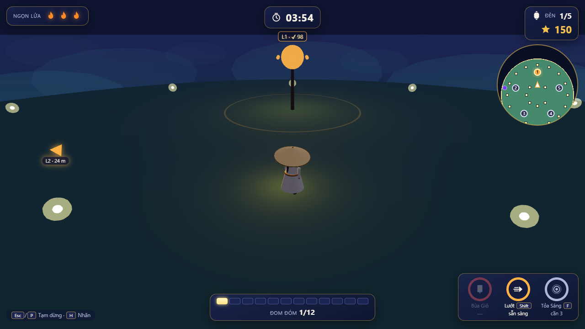

# Đảo Đèn Lồng — v1.0.0 (Phase 4 · Contract v1.3)

> 🎬 **Video Demo (< 5 phút):** [docs/demo/demo.mp4](docs/demo/demo.mp4) (2,82 MB · 1280×720 H.264 · và đính kèm tại [GitHub Release `v1.0.0`](https://github.com/TheWilsonGlobal/K5-L3A-Day12-PhamNgocSon-2A202603533-AI-SDLC/releases/tag/v1.0.0))
> 📜 **Tài liệu:** [CHANGELOG.md](CHANGELOG.md) · [CREDITS.md](CREDITS.md) · [LICENSE](LICENSE) · [Retrospective](docs/retro.md) · [Clarify Log](docs/clarify-log.md) · [AI Usage Log](docs/ai-usage-log.md) · [ADR-001](docs/adr/ADR-001-lantern-state-and-win-rule.md) · [Spec Phase 1–4](docs/spec/phase-4.md)

Game 3D góc nhìn người thứ ba (**Three.js / WebGL2** + **Simulation tất định 60 tick/s**): **Mây** gom đom đóm, thắp sáng và châm dầu giữ các Đèn Lồng Lớn cháy tới bình minh qua **3 Đêm** (Đảo Bến, Đảo Cau, Đảo Chuông), né **Bóng Mực** (chúng hút dầu đèn khi `fuel < 30`) và **Gió Lạc**, xua chúng bằng **Tỏa Sáng**, dùng **Lướt** và **Bùa Gió** vượt nguy hiểm.



| Đêm | Đảo | Đèn | Thời gian | Cần sáng lúc bình minh (`≥ 60%`) | Điểm nhấn |
| :-: | :--- | :-: | :-: | :-: | :--- |
| **1** | **Đảo Bến** | 5 | 240 s | `3/5` | Đảo tròn `R = 40 m`, Bóng Mực xuất hiện từ giây thứ 5 |
| **2** | **Đảo Cau** | 6 | 270 s | `4/6` | 2 đảo nối bằng cầu tre không lan can, 2 bục nhảy, Bùa Gió, Gió Lạc |
| **3** | **Đảo Chuông** | 7 | 300 s | `5/7` | 3 tầng (`Y = 0/3/6 m`), 2 dốc, bục nhảy, tháp chuông, gió mạnh, Bóng Mực `4,5 m/s` |

---

## Yêu cầu hệ thống

- **Node.js:** `>= 22.0.0` và **pnpm** (`>= 9`)
- **Trình duyệt:** Chrome / Edge / Firefox / Safari hỗ trợ **WebGL2** (khuyến nghị bật tăng tốc phần cứng GPU)
- **Hệ điều hành:** Windows, macOS hoặc Linux (kèm `Dockerfile` chuẩn `node:22-slim`)

---

## Cài đặt và chạy (3 lệnh từ repo sạch)

```bash
pnpm install
pnpm build
node scripts/run.mjs    # mở http://127.0.0.1:5173 (hoặc dùng `pnpm dev` khi phát triển)
```

---

## Điều khiển & Khả năng tiếp cận (Accessibility)

Mọi phím hành động đều có thể **đổi phím trong Cài đặt** (có phát hiện trùng phím và nút **Khôi phục mặc định**, lưu tự động):

| Phím mặc định | Hành động |
| :--- | :--- |
| `W A S D` / phím mũi tên | Di chuyển 4 hướng (theo hướng camera) |
| `Space` | **Nhảy** (`7,0 m/s`, trọng lực `-20 m/s²`, chỉ khi chạm đất) |
| `Shift` | **Lướt**: `14 m/s` trong `0,2 s`, hồi chiêu `1,5 s` (`0 s` khi có Bùa Gió) |
| `E` | **Tương tác**: Thắp mới (`10` đom đóm) / Thắp lại (`5` đom đóm) / Châm dầu (`+10 fuel`/đom đóm) cho đèn nhận được gần nhất trong `2 m` |
| `F` | **Tỏa Sáng**: tốn `3` đom đóm, choáng `2 s` và đẩy lùi `4 m` Bóng Mực trong `5 m`, hồi `3 s` |
| `Esc` / `P` | **Tạm dừng** (Tiếp tục / Chơi lại Đêm / Cài đặt / Hướng dẫn / Về menu) |
| `Q` / `R` hoặc kéo chuột | Xoay camera |
| `H` | Bật/tắt nhãn tên trực quan trên mọi thực thể |
| `Enter` | Bắt đầu Đêm, qua màn Kết quả |

### Tính năng Dễ tiếp cận (Accessibility)
- **Bảng màu dễ phân biệt (Chế độ mù màu):** Đổi viền/mắt Bóng Mực `#7A3CFF → #00B3FF`, cảnh báo `#FF5A5F → #FFFFFF` kèm biểu tượng `⚠`; đèn tắt xẹp `20%` chiều cao và có vết rách giấy để phân biệt không cần màu.
- **Phụ đề & Chỉ báo hình ảnh:** Phụ đề trực tiếp trên màn hình cho 4 sự kiện: Bóng Mực xuất hiện (**kèm mũi tên chỉ hướng ở mép màn hình**), gió mạnh sắp thổi, `10 s` cuối và đèn có `fuel < 30`.
- **Giảm chuyển động:** Tắt rung camera (`shake`) và hiệu ứng chớp sáng màn hình.
- **Cỡ chữ UI:** Toàn bộ chữ giao diện `≥ 18 px` ở `1280×720`, kèm tùy chọn **Chữ lớn (`×1.25`)**.

---

## Cách tính điểm & Bảng xếp hạng cục bộ

| Sự kiện | Điểm |
| :--- | :--- |
| Mỗi đom đóm nạp vào đèn (thắp mới, thắp lại, châm dầu) | `+5` |
| Thắp lần đầu / Thắp lại đèn đã tắt | `+100` / `+40` |
| Bóng Mực trúng Tỏa Sáng (thường / đang hút dầu `drain`) | `+5` / `+15` (thay cho `+5`) |
| Bình minh (chỉ khi thắng): mỗi đèn đang sáng | `+50 + floor(fuel)` |
| Bình minh (chỉ khi thắng): mỗi Ngọn Lửa còn lại | `+50` |

- Sau màn hình **Bình Minh** (thắng Đêm 3) hoặc sau khi **thua ở bất kỳ Đêm nào**, người chơi nhập tên (`3–12` ký tự `[A-Za-z0-9_]`) để lưu vào **Bảng xếp hạng Top 10** trên đĩa cục bộ (`.data/leaderboard.json`).
- Xuất bảng xếp hạng ra file JSON từ CLI:

```bash
node scripts/run.mjs --export-leaderboard out.json
```

---

## Kiểm thử, Headless, Benchmark & Soak Test (Contract v1.3)

### 1. Chạy bộ kiểm thử tự động (Vitest)
```bash
pnpm test
pnpm typecheck && pnpm lint
```

### 2. Chạy Headless CLI (`headless_cmd`)
```bash
node apps/headless/dist/headless.js --seed 1 --night 1 \
  [--scenario scenario.json] [--inputs inputs.json] --ticks 600 --out out.jsonl [--snapshot-every 10]
```
- Tất định tuyệt đối từng byte giữa Windows và Docker Linux (`node:22-slim`).
- Mã thoát: `0` thành công · `2` lỗi định dạng/logic scenario hoặc inputs · `1` lỗi tham số CLI.

### 3. Chạy Benchmark (`bench_cmd`)
```bash
node scripts/bench.mjs --seed 42 --duration 30 --out bench.json
```
- Mở cửa sổ `1280×720` (tắt vsync `--disable-gpu-vsync`), tải Đêm 1 với `200` Bóng Mực `wander`, `100` đom đóm, `L1–L3` sáng `fuel = 100`, camera bay vòng tròn `r = 30 m, Y = 15 m` (`15 s/vòng`), bỏ `3 s` khởi động, đo trong `--duration` giây và ghi [bench.json](bench.json).

### 4. Chạy Soak Test (`soak_cmd`)
```bash
node scripts/soak.mjs --seed 7 --nights 10 --out soak.json
```
- Chạy `10` Đêm liên tiếp (`1 → 2 → 3` xoay vòng, seed `7 + i`) trong cùng một tiến trình với input ngẫu nhiên theo seed, kiểm tra ổn định bộ nhớ (`crashes = 0`, `mem_end_mb ≤ 1.2 × mem_start_mb`) và ghi [soak.json](soak.json).

### 5. Chạy bằng Docker
```bash
docker build -t ddl-headless .
docker run --rm -v "$PWD:/w" ddl-headless --seed 1 --night 2 --ticks 600 --out /w/out.jsonl
```

---

## Sáng tạo của tôi

- Tạo hình thủ tục cho **Mây** (nón lá, khăn đỏ, đèn lồng nhỏ đung đưa theo nhịp bước), **Bóng Mực**, **Gió Lạc** (dải lụa lượn sóng), **Bùa Gió** và lời dẫn của **Ông Đăng** đầu mỗi Đêm.
- Âm thanh và nhạc nền chuông ngũ cung tổng hợp hoàn toàn bằng **Web Audio API** (không cần file âm thanh rời).
- Minimap xoay theo hướng nhìn của camera kèm nhãn trực quan (`H`), mũi tên chỉ đèn cần chăm và mũi tên cảnh báo hướng Bóng Mực vừa xuất hiện.
